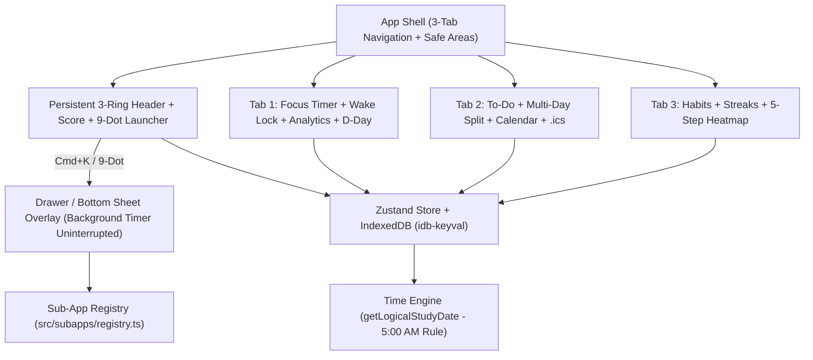

# PLAN.md — UProSC Phased Implementation Plan

## 1. Product Vision & Core Loop
Build **UProSC**, an offline-first Progressive Web App (PWA) combining **YPT (Yeolpumta)** study tracking, **Apple Health** activity rings, **HabitKit** streak heatmaps, and **Duolingo** behavioral reinforcement.

- **Target Platforms:** iOS (Safari Add to Home Screen), Android (Chrome PWA), macOS, and Windows.
- **Strict Layout Rule:** Strictly **3 primary tabs** (`Timer`, `To-Do`, `Habits`) plus a persistent **3-Ring Header** and top-right **9-dot App Launcher**.

---

## 2. Confirmed Design Decisions
- **Workspace Cleanup:** Approved to delete leftover `.next/` directory and replace the Next.js `.gitignore` when starting Phase 1.
- **Day-1 Hosting:** **Cloudflare Pages + GitHub** (user will supply/connect their own chosen accounts; do not auto-link any existing account).
- **Zero-Item Ring Behavior:** `0%` when 0 tasks are due or 0 habits are active.
- **Productivity Score:** `45% Focus + 35% To-Do + 20% Habits` (each ring capped at `100%`). Streak multiplier bonus is deferred for later.
- **5:00 AM Boundary Crossing:** Split study sessions cleanly at `5:00 AM` local time across the two logical days.
- **Theme:** **System-adaptive** (light & dark matching OS preference from Day 1).
- **Execution Workflow:** Explain *"what is implemented / what is going to be implemented"* and wait for user approval before executing each phase.

---

## 3. System Architecture



### Shared Core Domain Types (`src/types/domain.ts`)

```ts
export type LogicalDate = string; // "YYYY-MM-DD" shifted back by 5 hours (local time)

export interface Subject {
  id: string;
  name: string;
  color: string;
  dailyGoalMinutes: number;
  archived: boolean;
  createdAt: number;
}

export interface StudySession {
  id: string;
  subjectId: string;
  startTime: number; // epoch ms
  endTime: number;   // epoch ms
  durationSeconds: number;
  logicalDate: LogicalDate;
}

export interface TodoTask {
  id: string;
  title: string;
  logicalDate: LogicalDate;
  completed: boolean;
  priority: 'low' | 'medium' | 'high';
  parentMultiDayId?: string;
  sliceIndex?: number;       // e.g., 1
  sliceTotal?: number;       // e.g., 10
  unitTarget?: number;       // e.g., 20 (pages)
  unitLabel?: string;        // e.g., "pages"
  scheduledTime?: string;    // "HH:mm" optional for .ics export
}

export interface MultiDayTaskPlan {
  id: string;
  title: string;
  startDate: LogicalDate;
  endDate: LogicalDate;
  totalUnits?: number;
  unitLabel?: string;
  splitEvenly: boolean;
  priority: 'low' | 'medium' | 'high';
}

export interface Habit {
  id: string;
  name: string;
  icon: string;
  color: string;
  archived: boolean;
  createdAt: number;
  completedDates: Record<LogicalDate, boolean>;
}
```

---

## 4. Phased Roadmap

### Phase 1: Project Scaffold, Strict 3-Tab Shell, PWA Setup & Day-1 Live Deployment
- **Goal:** Create a clean, installable Vite + React + TS + Tailwind PWA shell with strict 3-tab navigation and initialize local Git ready for Cloudflare Pages deployment.
- **Web Dev Concepts:** Vite bundling, TypeScript config, Tailwind utility layout & iOS `env(safe-area-inset-*)`, PWA `manifest.webmanifest` + Service Workers (`vite-plugin-pwa`), Git workflow & Cloudflare Pages CI/CD.
- **Files:**
  - `[DELETE]` `.next/`
  - `[MODIFY]` `.gitignore`
  - `[NEW]` `package.json`, `tsconfig.json`, `vite.config.ts`, `index.html`, `public/icons/*`
  - `[NEW]` `src/App.tsx`, `src/main.tsx`, `src/index.css`, `src/components/Header/AppHeader.tsx`
- **Hosting Step:** Initialize local `git init` and initial commit, then guide the user to push to their chosen GitHub repo and connect Cloudflare Pages for an immediate `https://...` PWA URL.

### Phase 2: Time Engine, IndexedDB Persistence & Interactive 3-Ring Header
- **Goal:** Build the 5:00 AM logical date engine, offline-first Zustand + IndexedDB store, and live interactive 3-Ring Global Header with `45/35/20` Productivity Score.
- **Web Dev Concepts:** Local vs UTC `Date` pitfalls, Vitest unit testing, IndexedDB (`idb-keyval`) vs `localStorage`, Zustand selectors, SVG circle progress geometry (`stroke-dasharray` / `stroke-dashoffset`), hover & touch-hold popovers.
- **Files:**
  - `[NEW]` `src/types/domain.ts`, `src/utils/date.ts`, `src/utils/score.ts`, `src/utils/__tests__/date.test.ts`, `src/utils/__tests__/score.test.ts`
  - `[NEW]` `src/store/idbStorage.ts`, `src/store/useAppStore.ts`
  - `[NEW]` `src/components/Header/ActivityRing.tsx`, `[MODIFY]` `AppHeader.tsx`

### Phase 3: Focus Timer, Wake Lock, Analytics, Behavioral Engine & D-Day Tracker (Tab 1)
- **Goal:** Implement count-up stopwatch + countdown Pomodoro/custom blocks, subject management, timestamp-accurate logging, Full-Screen + Screen Wake Lock API, D-Day goal tracker, SVG analytics charts, and Duolingo-inspired positive/loss-aversion companion.
- **Web Dev Concepts:** Timestamp-delta timing vs `setInterval` throttling, Screen Wake Lock & Page Visibility APIs, Web Audio synthesis chimes, custom SVG charts (timeline, donut, peak hours), behavioral pace derivation.
- **Files:**
  - `[NEW]` `src/hooks/useTimestampTimer.ts`, `src/hooks/useWakeLock.ts`, `src/utils/sound.ts`, `src/utils/focusAnalytics.ts`, `src/utils/behavioral.ts`
  - `[NEW]` `src/features/timer/TimerTab.tsx`, `FullScreenClock.tsx`, `SubjectManager.tsx`, `DDayTracker.tsx`, `BehavioralCompanion.tsx`, `FocusAnalytics.tsx`, `subjectColors.ts`
  - `[MODIFY]` `src/types/domain.ts`, `src/utils/score.ts`, `src/store/useAppStore.ts`, `src/components/Header/AppHeader.tsx`, `src/App.tsx`

### Phase 4: To-Do List, Multi-Day Auto-Split & Calendar / `.ics` Integration (Tab 2)
- **Goal:** Implement Today's Tasks (5:00 AM boundary) with priority tags feeding Ring 2, One-Time & Multi-Day tasks with *"Split Evenly Across Days"*, collapsible Monthly/Weekly Calendar view (task loads, spans, deadlines, D-Day), and one-click RFC 5545 `.ics` export.
- **Web Dev Concepts:** Relational client state (`MultiDayTaskPlan` + daily `TodoTask` slices), remainder-balanced integer division, CSS Grid calendar layouts, client-side `Blob` download + `.ics` spec.
- **Files:**
  - `[NEW]` `src/utils/taskSplit.ts`, `src/utils/icsExport.ts`, `src/utils/__tests__/taskSplit.test.ts`, `src/utils/__tests__/icsExport.test.ts`
  - `[NEW]` `src/features/todo/TodoTab.tsx`, `TaskComposerModal.tsx`, `CalendarView.tsx`

### Phase 5: Daily Habits, Streak Engine & 5-Step Consistency Heatmap (Tab 3)
- **Goal:** Implement Daily Habits checklist (one-tap checkboxes, custom icons/colors) feeding Ring 3, Current & Best Streak engine (5:00 AM boundary aware), and a GitHub/HabitKit-style 5-step intensity consistency heatmap.
- **Web Dev Concepts:** Time-series streak calculation (avoiding morning false-zero resets), 5-step discrete intensity mapping (`0%` to `100%`), memoized grid aggregation, touch/hover heatmap tooltips.
- **Files:**
  - `[NEW]` `src/utils/habitStats.ts`, `src/utils/__tests__/habitStats.test.ts`
  - `[NEW]` `src/features/habits/HabitsTab.tsx`, `ConsistencyHeatmap.tsx`

### Phase 6: Modular Sub-Apps Architecture, Landscape Optimization & Full PWA Audit
- **Goal:** Implement `src/subapps/registry.ts` plugin registry, 9-dot App Launcher (`Cmd/Ctrl + K`), responsive Drawer (desktop) / Bottom Sheet (mobile) overlay keeping active timers uninterrupted, starter sub-apps (Ambient Focus Audio + JSON Backup/Restore), **Landscape Optimization** across all 3 tabs + Full-Screen Timer (handling short viewports, left/right notched safe areas `env(safe-area-inset-left/right)`, and split two-column layouts on mobile/tablet landscape), and full offline/cross-platform PWA audit.
- **Web Dev Concepts:** Plugin/registry architecture, `React.lazy` & `Suspense` code splitting, global keyboard shortcuts & accessible modals, Web Audio noise synthesis, responsive `orientation: landscape` & short-viewport (`max-height`) CSS/Tailwind layouts + safe-area insets, Lighthouse PWA & offline verification.
- **Files:**
  - `[NEW]` `src/subapps/types.ts`, `src/subapps/registry.ts`, `src/components/SubAppHost/AppLauncherPopover.tsx`, `SubAppDrawer.tsx`
  - `[NEW]` `src/subapps/ambient-audio/*`, `src/subapps/backup-sync/*`
  - `[MODIFY]` App shell, Header, Full-Screen Timer, Calendar, and Heatmap layouts for **Landscape Optimization**

---

## 5. Verification Plan
- **Automated Tests (Vitest), Typecheck & Build:** Run `export PATH="/opt/homebrew/bin:$PATH" && npx tsc --noEmit && npx vitest run && npm run build` after every phase.
- **Per-Phase Cross-Platform Portrait & Landscape Tests:** After every phase, add/update automated tests covering **macOS, Windows, iOS, and Android** in **both Portrait and Landscape** layouts (verifying safe-area insets, short-viewport landscape rules, light/dark `prefers-color-scheme` support, and phase UI interactions across all 8 profiles in `src/__tests__/crossPlatformLayout.test.tsx` or feature tests).
- **Manual Cross-Platform PWA Verification:**
  - Install via iOS Safari (`Add to Home Screen`) and Chrome (`Install App`) using live Cloudflare Pages HTTPS URL.
  - Verify strict 3-tab + 3-ring layout with safe-area padding (portrait & **Landscape Optimization** on mobile/tablet) on macOS, Windows, iOS, and Android, plus light/dark OS theme adaptation.
  - Test Airplane Mode offline reload, background timer wall-clock accuracy, Screen Wake Lock in full-screen, cross-tab Ring/Score updates, and uninterrupted background timer while opening Sub-Apps.
